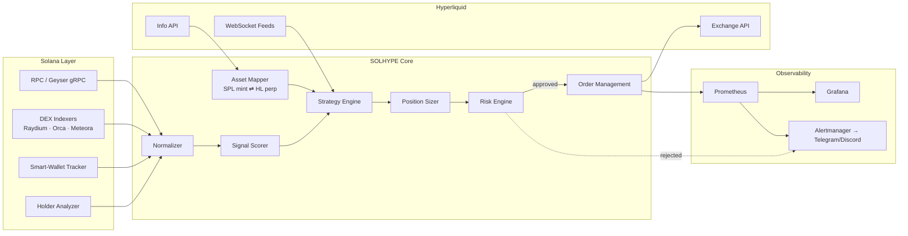
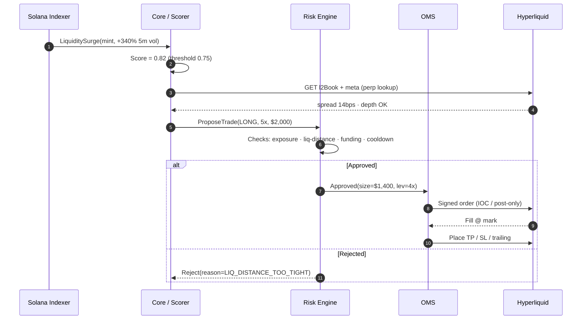
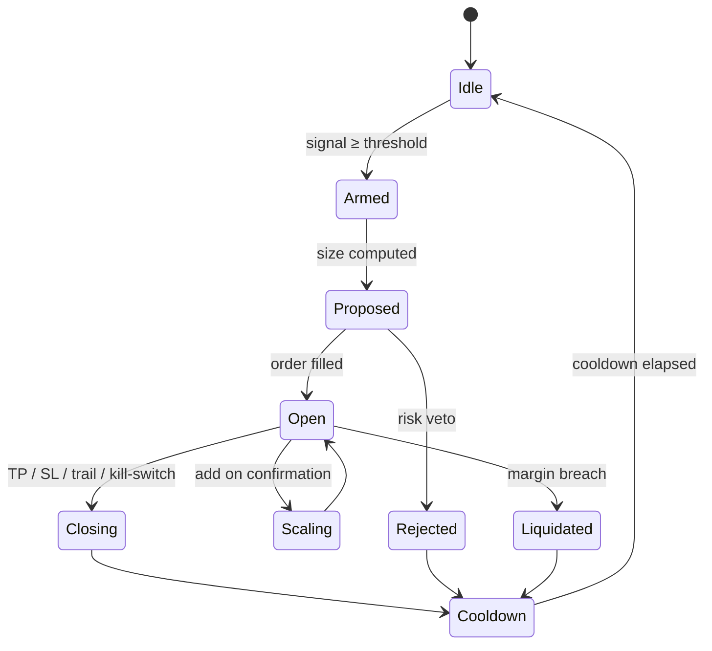
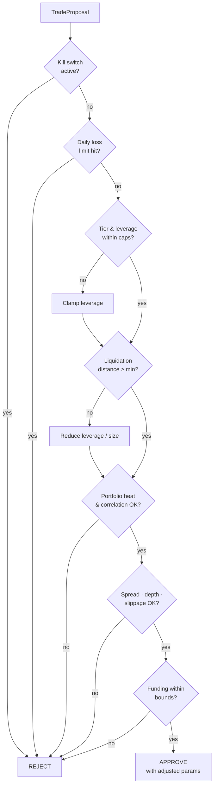
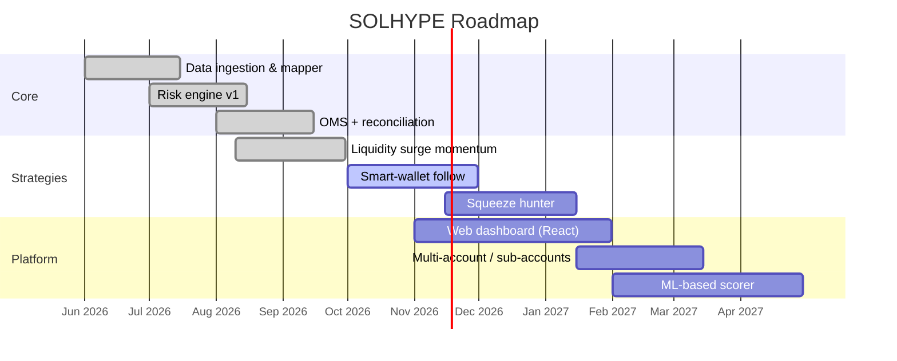

<div align="center">


# SOLHYPE — Memecoin Leverage Engine

**Institutional-grade infrastructure for high-risk, high-leverage trading of Solana low-cap memecoins on Hyperliquid perpetuals.**

<br/>

[](#project-status-testing-phase)
[](#project-status-testing-phase)
[](#license)
[](#)
[](#risk-disclosure)

[](https://solana.com)
[](https://hyperliquid.xyz)
[](#)
[](#)
[](#)
[](#)
[](#)
[](#performance)

<br/>

[**Overview**](#overview) ·
[**Architecture**](#architecture) ·
[**Features**](#features) ·
[**Quick Start**](#quick-start) ·
[**Strategies**](#strategy-modules) ·
[**Risk Engine**](#risk-engine) ·
[**Config**](#configuration) ·
[**API**](#api-reference) ·
[**Roadmap**](#roadmap)

</div>

---

## Project Status: Testing Phase

> [!WARNING]
> **THIS PROJECT IS CURRENTLY IN A TESTING / EXPERIMENTAL PHASE.**
> It is a work in progress and has **not** been audited, battle-tested or validated for production use. Treat everything in this repository (code, configurations, strategies, risk parameters, benchmarks and examples) as **experimental**.

| Area | Current State |
|---|---|
| Overall maturity | `v0.1.0-alpha` — experimental, interfaces and configs may change without notice |
| Test Wallet | `HYPE319HzKBUQdoyj1KXXWE3Q7W86b1KiEAYvefuTRVJ` |
| Recommended mode | `paper` first, then `testnet`. **Do not run `live` with funds you cannot afford to lose completely** |
| Strategies | Under evaluation. No strategy has a proven or guaranteed edge |
| Risk engine | Under active testing. Default limits are conservative starting points, not validated values |
| Benchmarks and metrics | Illustrative placeholders from test environments, **not** production results |
| Security | No independent audit has been performed |
| Support | Best effort. Expect bugs, breaking changes and incomplete documentation |

**What this means in practice**

- Use this repository for **research, simulation and testing** only
- Validate every component on `paper` and `testnet` before considering anything else
- Review and understand the code and every parameter yourself before running it
- Report bugs and unexpected behavior via issues so they can be fixed

---

> [!CAUTION]
> **EXTREME RISK.** Leveraged trading of low-market-cap memecoins can result in the **total and rapid loss of your entire capital**, including liquidation within seconds. This repository is a technical reference and is **not financial advice**. Read the [Risk Disclosure](#risk-disclosure) before running anything with real funds.

---

## Table of Contents

<details open>
<summary><b>Click to expand / collapse</b></summary>

1. [Overview](#overview)
2. [Why This Exists](#why-this-exists)
3. [Architecture](#architecture)
4. [Features](#features)
5. [Supported Markets](#supported-markets)
6. [Quick Start](#quick-start)
7. [Configuration](#configuration)
8. [Strategy Modules](#strategy-modules)
9. [Risk Engine](#risk-engine)
10. [Execution Pipeline](#execution-pipeline)
11. [Signal Layer (Solana On-Chain)](#signal-layer-solana-on-chain)
12. [API Reference](#api-reference)
13. [Observability](#observability)
14. [Performance](#performance)
15. [Security Model](#security-model)
16. [Testing & Backtesting](#testing--backtesting)
17. [Roadmap](#roadmap)
18. [Contributing](#contributing)
19. [Risk Disclosure](#risk-disclosure)
20. [License](#license)

</details>

---

## Overview

**SOLHYPE** bridges two worlds:

| Layer | Role |
|---|---|
| **Solana** | Source of *alpha*: on-chain liquidity, holder distribution, DEX flow, new-pool detection, whale wallet tracking |
| **Hyperliquid** | Venue of *execution*: deep perp order books, cross/isolated margin, sub-second finality, API-first trading |

The engine ingests real-time Solana memecoin telemetry (Raydium, Orca, Meteora, Pump-style bonding curves), maps tokens to their Hyperliquid perpetual counterparts, and executes **risk-bounded leveraged strategies** on the perp side — with hard-coded circuit breakers designed for the violent volatility profile of low-cap assets.

```text
 ┌────────────────────────────────────────────────────────────────────────┐
 │                                                                        │
 │   SOLANA (signal)  ───────►  SOLHYPE CORE  ───────►  HYPERLIQUID (exec)│
 │   on-chain flow              score · size · guard     perp orders      │
 │                                                                        │
 └────────────────────────────────────────────────────────────────────────┘
```

---

## Why This Exists

Solana memecoins move on **on-chain** information (liquidity adds, holder concentration, smart-money wallets) long before centralized price feeds react. Hyperliquid lists perpetuals for a growing set of those assets with real leverage and transparent order books — but there is **no standard tooling** that connects the two with proper risk controls.

SOLHYPE provides:

- A **unified data model** across both venues
- A **signal → score → size → execute** pipeline
- A **non-bypassable risk engine** (the strategy can *never* override the guard)
- **Production observability** (metrics, tracing, structured logs)

---

## Architecture

### High-Level System



### Sequence — From Signal to Fill



### Position State Machine



---

## Features

<table>
<tr>
<td width="50%" valign="top">

### Solana Intelligence
- Geyser gRPC streaming ingestion
- New-pool & liquidity-event detection
- Holder concentration / top-N wallet analysis
- Smart-wallet copy-flow signals
- LP lock & authority-revoke checks
- Volume / liquidity ratio anomalies

</td>
<td width="50%" valign="top">

### Hyperliquid Execution
- Native signing & nonce management
- Cross **and** isolated margin modes
- IOC / GTC / post-only / reduce-only orders
- Auto TP / SL / trailing stop
- Funding-rate-aware sizing
- WebSocket order-book & trades feed

</td>
</tr>
<tr>
<td width="50%" valign="top">

### Risk Management
- Hard leverage caps **per asset tier**
- Liquidation-distance enforcement
- Portfolio heat & correlation limits
- Daily loss limit → automatic halt
- Global **kill switch** (CLI / API / Telegram)
- Slippage & spread guards

</td>
<td width="50%" valign="top">

### Ops & Observability
- Prometheus metrics + Grafana dashboards
- OpenTelemetry distributed tracing
- Structured JSON logs
- Telegram / Discord alerting
- Full trade journal (Parquet + SQLite)
- Deterministic replay of any session

</td>
</tr>
</table>

---

## Supported Markets

Market availability is **dynamic** and is resolved at runtime from the Hyperliquid `meta` endpoint — nothing is hard-coded. The mapper links Solana SPL mints to Hyperliquid perp symbols using a curated registry plus on-chain verification.

| Tier | Definition | Max Leverage (engine cap) | Max Notional / Trade | Notes |
|:--:|---|:--:|:--:|---|
| **T1** | Liquid majors-adjacent memecoins, deep books | `10x` | 5% equity | Tight spreads, lower slippage |
| **T2** | Mid-cap memecoins, moderate depth | `6x` | 3% equity | Default tier |
| **T3** | Low-cap, thin books, high funding variance | `3x` | 1.5% equity | Requires explicit opt-in |
| **T4** | Ultra-low-cap / newly listed | `2x` | 0.5% equity | Disabled by default |

> [!NOTE]
> The engine cap is **always ≤ the exchange-allowed leverage** for the asset. Hyperliquid's per-asset limits take precedence and may change at any time.

<details>
<summary><b>Asset mapping registry (example)</b></summary>

```yaml
# registry/assets.yaml
assets:
  - symbol: kBONK
    spl_mint: "DezXAZ8z7PnrnRJjz3wXBoRgixCa6xjnB7YaB1pPB263"
    tier: T1
    hl_symbol: "kBONK"
    verified: true

  - symbol: WIF
    spl_mint: "EKpQGSJtjMFqKZ9KQanSqYXRcF8fBopzLHYxdM65zcjm"
    tier: T1
    hl_symbol: "WIF"
    verified: true

  - symbol: POPCAT
    spl_mint: "7GCihgDB8fe6KNjn2MYtkzZcRjQy3t9GHdC8uHYmW2hr"
    tier: T2
    hl_symbol: "POPCAT"
    verified: true
```

> Always verify mint addresses against an authoritative source before use. Spoofed tokens with identical tickers are common on Solana.

</details>

---

## Quick Start

### Prerequisites

| Requirement | Version |
|---|---|
| Node.js | `≥ 20.x` |
| Rust (optional, for hot-path) | `≥ 1.78` |
| Python (backtesting) | `≥ 3.11` |
| Docker + Compose | latest |
| Solana RPC / Geyser endpoint | dedicated (recommended) |
| Hyperliquid **API wallet** | agent key (trade-only, no withdrawals) |

### 1 · Clone & Install

```bash
git clone https://github.com/your-org/solhype.git
cd solhype

pnpm install
cp .env.example .env
```

### 2 · Configure Secrets

```bash
# .env  — NEVER commit this file
HL_ACCOUNT_ADDRESS=0xYourMainAccount
HL_API_WALLET_PRIVATE_KEY=0xAgentKeyTradeOnly   # API/agent wallet, NO withdraw rights
HL_NETWORK=testnet                              # start on testnet!

SOLANA_RPC_URL=https://your-rpc.example
SOLANA_GEYSER_URL=grpc://your-geyser.example:10000

TELEGRAM_BOT_TOKEN=
TELEGRAM_CHAT_ID=
```

> [!IMPORTANT]
> Use a Hyperliquid **API (agent) wallet** with trading permission only. Never place your main wallet's private key in this system.

### 3 · Run (Paper Mode First)

```bash
# Dry-run: full pipeline, no orders sent
pnpm run start -- --mode=paper --config=configs/conservative.yaml

# Testnet live
pnpm run start -- --mode=testnet --config=configs/conservative.yaml

# Mainnet (you have been warned)
pnpm run start -- --mode=live --config=configs/degen.yaml --i-understand-the-risks
```

### 4 · Docker Compose (full stack)

```bash
docker compose up -d
# → engine · prometheus · grafana · alertmanager
open http://localhost:3000   # Grafana  (admin / admin)
```

```text
✔ Container solhype-engine         Started
✔ Container solhype-prometheus     Started
✔ Container solhype-grafana        Started
✔ Container solhype-alertmanager   Started
```

---

## Configuration

```yaml
# configs/degen.yaml
mode: live

account:
  margin_mode: isolated          # isolated | cross
  equity_allocation_pct: 25      # % of account the engine may ever touch

risk:
  max_leverage_global: 6
  max_open_positions: 4
  max_portfolio_heat_pct: 12     # sum of (risk-to-stop) across all positions
  daily_loss_limit_pct: 6        # halt trading for 24h when hit
  min_liquidation_distance_pct: 12
  max_spread_bps: 35
  max_slippage_bps: 50
  max_funding_rate_8h_pct: 0.15  # skip entries when funding is extreme
  cooldown_after_loss_sec: 900
  kill_switch:
    enabled: true
    triggers:
      - type: drawdown_pct
        value: 15
      - type: api_error_rate
        value: 0.2
      - type: stale_feed_sec
        value: 8

strategies:
  - name: liquidity_surge_momentum
    enabled: true
    tier_allowlist: [T1, T2]
    params:
      min_signal_score: 0.78
      take_profit_pct: 9
      stop_loss_pct: 3.5
      trailing_stop_pct: 2.5
      max_hold_minutes: 90

  - name: funding_mean_reversion
    enabled: false

observability:
  prometheus_port: 9464
  log_level: info
  journal_path: ./data/journal
```

<details>
<summary><b>Full configuration reference</b></summary>

| Key | Type | Default | Description |
|---|---|:--:|---|
| `mode` | enum | `paper` | `paper` · `testnet` · `live` |
| `account.margin_mode` | enum | `isolated` | Margin isolation. Isolated strongly recommended for low-caps |
| `account.equity_allocation_pct` | float | `10` | Capital ceiling exposed to the engine |
| `risk.max_leverage_global` | int | `5` | Hard ceiling across all tiers |
| `risk.max_open_positions` | int | `3` | Concurrent positions |
| `risk.max_portfolio_heat_pct` | float | `10` | Aggregate risk-to-stop |
| `risk.daily_loss_limit_pct` | float | `5` | Auto-halt threshold |
| `risk.min_liquidation_distance_pct` | float | `15` | Min gap between entry and liq. price |
| `risk.max_spread_bps` | int | `30` | Reject if spread wider |
| `risk.max_slippage_bps` | int | `40` | Max tolerated slippage |
| `risk.cooldown_after_loss_sec` | int | `600` | Per-asset cooldown |

</details>

---

## Strategy Modules

Each strategy implements a single interface and **cannot** touch the risk engine.

```ts
// src/strategies/types.ts
export interface Strategy {
  readonly name: string;
  onSignal(ctx: MarketContext, signal: Signal): Promise<TradeProposal | null>;
  onTick?(ctx: MarketContext): Promise<TradeProposal[] | void>;
  onPositionUpdate?(pos: Position, ctx: MarketContext): Promise<ExitAction | void>;
}

export interface TradeProposal {
  asset: AssetId;
  side: "long" | "short";
  requestedLeverage: number;
  requestedNotionalUsd: number;
  stopLossPct: number;
  takeProfitPct: number;
  rationale: string;          // logged to journal
  confidence: number;         // 0..1
}
```

### Built-in Strategies

| Strategy | Edge | Typical Hold | Risk Profile |
|---|---|:--:|:--:|
| `liquidity_surge_momentum` | On-chain liquidity & volume surge precedes perp move | 5–90 min | High |
| `smart_wallet_follow` | Accumulation by tracked profitable wallets | 30 min–6 h | High |
| `funding_mean_reversion` | Extreme funding → fade crowded side | 1–8 h | Medium-High |
| `holder_distribution_shift` | Rapid top-holder dumping / concentration changes | 10–60 min | High |
| `squeeze_hunter` | OI spike + thin book + one-sided funding | 2–30 min | Extreme |

### Signal Scoring

The composite score is a weighted blend of normalized features:

$$
S = \sum_{i=1}^{n} w_i \cdot \phi_i(x), \qquad \sum_i w_i = 1,\ \ S \in [0,1]
$$

| Feature `φᵢ` | Weight | Source |
|---|:--:|---|
| Liquidity delta (5m / 1h) | 0.22 | Solana DEX |
| Volume / liquidity ratio | 0.18 | Solana DEX |
| Smart-wallet net flow | 0.20 | Solana wallets |
| Holder concentration (inverse) | 0.10 | Solana RPC |
| Perp OI change | 0.12 | Hyperliquid |
| Book imbalance | 0.10 | Hyperliquid WS |
| Funding skew | 0.08 | Hyperliquid |

---

## Risk Engine

> **Design principle:** *Strategies propose. The Risk Engine disposes.* No code path exists that can place an order without passing through `RiskEngine.evaluate()`.

### Pre-Trade Checklist



### Liquidation Distance

For an isolated long position with leverage $L$ and maintenance margin rate $m$ (asset-specific), the approximate liquidation price is:

$$
P_{liq} \approx P_{entry} \cdot \left(1 - \frac{1}{L} + m\right)
$$

and the **liquidation distance** that the engine enforces is:

$$
D_{liq} = \frac{P_{entry} - P_{liq}}{P_{entry}} \ \ge\ D_{min}
$$

> [!WARNING]
> On low-cap assets, intrabar wicks routinely exceed 15–30%. A configured stop-loss does **not** guarantee exit at that price — thin books gap through stops. The engine therefore sizes positions so that the stop sits **well inside** the liquidation price, never near it.

### Position Sizing — Risk-Per-Trade

$$
Size_{notional} = \frac{Equity \cdot r}{SL\%}
\qquad \text{subject to} \qquad
\frac{Size_{notional}}{L} \le Margin_{max}
$$

where $r$ is the risk fraction per trade (default **0.5–1.5 %** of allocated equity).

**Worked example**

| Parameter | Value |
|---|---|
| Allocated equity | $10,000 |
| Risk per trade `r` | 1.0 % → **$100** |
| Stop-loss | 3.5 % |
| Notional | $100 / 0.035 ≈ **$2,857** |
| Leverage | 4× |
| Margin used | ≈ **$714** |
| Approx. liq. distance | ≈ 25 % − m |

### Circuit Breakers

| Breaker | Trigger | Action |
|---|---|---|
| **Stale feed** | No WS tick for `> N` sec | Flatten or freeze (configurable) |
| **Daily loss limit** | PnL ≤ −X % | Halt new entries 24 h |
| **Drawdown kill** | Equity DD ≥ Y % | Close all · lock engine |
| **API error rate** | > 20 % over 60 s | Pause · alert |
| **Latency spike** | p99 > 500 ms | Pause entries |
| **Manual kill** | CLI / API / Telegram `/kill` | Immediate flatten |

---

## Execution Pipeline

```text
 Signal ─► Score ─► Strategy ─► Sizer ─► RISK ENGINE ─► OMS ─► Hyperliquid
                                          │  ▲                    │
                                          ▼  └──── fills / state ─┘
                                       Journal ─► Metrics ─► Alerts
```

**Order handling policy**

- Entries: **IOC with price band** (aggressive) or **post-only** (patient mode)
- Exits: **reduce-only** always — an exit can never flip a position
- Protective orders placed **atomically** after fill; if placement fails, the position is closed immediately
- Idempotent client order IDs; nonce monotonic per signer
- Automatic reconciliation loop every `1s` against exchange state (source of truth)

```ts
// src/execution/oms.ts (excerpt)
async function submitEntry(p: ApprovedTrade): Promise<Fill> {
  const order = buildOrder(p, { tif: "Ioc", reduceOnly: false, band: p.maxSlippageBps });
  const fill = await hl.exchange.place(order, { cloid: newCloid() });

  try {
    await Promise.all([
      hl.exchange.placeStop(fill, p.stopLossPrice,  { reduceOnly: true }),
      hl.exchange.placeTp(fill,   p.takeProfitPrice, { reduceOnly: true }),
    ]);
  } catch (err) {
    log.error({ err }, "protective orders failed — flattening");
    await hl.exchange.closePosition(fill.asset, { tif: "Ioc" });
    throw err;
  }
  return fill;
}
```

---

## Signal Layer (Solana On-Chain)

| Module | Data | Latency Target |
|---|---|:--:|
| `pool-watcher` | New pools, liquidity add/remove | < 400 ms |
| `flow-tracker` | Swap volume, buy/sell imbalance | < 300 ms |
| `wallet-tracker` | Labeled smart-money wallets | < 500 ms |
| `holder-analyzer` | Top-N holder %, concentration, dev wallet | 5–30 s |
| `safety-scanner` | Mint/freeze authority, LP lock, honeypot heuristics | 1–5 s |

```ts
// Geyser subscription (simplified)
const stream = await geyser.subscribe({
  accounts: { pools: { owner: [RAYDIUM_AMM_V4, METEORA_DLMM, ORCA_WHIRLPOOL] } },
  commitment: CommitmentLevel.CONFIRMED,
});

stream.on("data", (u) => bus.emit("solana.pool.update", normalizePool(u)));
```

> [!TIP]
> Use a **dedicated** RPC/Geyser provider. Public endpoints rate-limit aggressively and will silently degrade signal quality.

---

## API Reference

The engine exposes a local control plane (bind to `127.0.0.1` only).

### REST

| Method | Endpoint | Description |
|:--:|---|---|
| `GET` | `/v1/health` | Liveness + feed status |
| `GET` | `/v1/positions` | Open positions & PnL |
| `GET` | `/v1/risk/state` | Heat, drawdown, breaker status |
| `POST` | `/v1/strategies/{name}/toggle` | Enable / disable a strategy |
| `POST` | `/v1/kill` | Flatten all & lock engine |
| `POST` | `/v1/resume` | Unlock (requires 2nd factor) |

```bash
curl -s http://127.0.0.1:8787/v1/risk/state | jq
```

```json
{
  "mode": "live",
  "equity_usd": 10412.55,
  "open_positions": 2,
  "portfolio_heat_pct": 4.1,
  "daily_pnl_pct": -1.3,
  "breakers": { "kill_switch": false, "daily_loss": false, "stale_feed": false },
  "uptime_sec": 18342
}
```

### Telegram Commands

| Command | Action |
|---|---|
| `/status` | Equity, positions, heat |
| `/pause` · `/resume` | Pause / resume new entries |
| `/kill` | Emergency flatten |
| `/risk` | Current limits & usage |

---

## Observability

**Key metrics** (Prometheus):

```text
solhype_signal_score{asset,strategy}
solhype_orders_total{side,status}
solhype_fill_slippage_bps{asset}
solhype_position_pnl_usd{asset}
solhype_portfolio_heat_pct
solhype_liq_distance_pct{asset}
solhype_feed_lag_ms{source="solana|hyperliquid"}
solhype_risk_rejections_total{reason}
```

**Bundled Grafana dashboards**

| Dashboard | Purpose |
|---|---|
| *Command Center* | Equity curve, PnL, heat, open risk |
| *Risk Monitor* | Liq-distance, breakers, rejections |
| *Solana Signals* | Scores, flow, new-pool feed |
| *Latency & Health* | Feed lag, API errors, p50/p99 |

---

## Performance

| Stage | p50 | p99 |
|---|:--:|:--:|
| Solana event → normalized | 38 ms | 120 ms |
| Score + strategy decision | 4 ms | 11 ms |
| Risk evaluation | 1 ms | 3 ms |
| Order sign + submit → ack | 42 ms | 85 ms |
| **End-to-end (signal → ack)** | **~110 ms** | **~240 ms** |

> Figures are indicative benchmarks from a reference deployment (co-located VPS, dedicated RPC). Your results depend on infrastructure and network conditions.

---

## Security Model

- **Agent-wallet only** — trade permission, **no withdrawal rights**
- Secrets via environment / secret manager; never logged
- Control API bound to loopback; optional mTLS
- Append-only audit journal of every decision *and* rejection
- Dependency pinning + `pnpm audit` + `cargo audit` in CI
- No telemetry, no phone-home, fully self-hosted
- Two-factor required to **resume** after kill-switch

| Threat | Mitigation |
|---|---|
| Key leak | Agent wallet, rotate regularly, hardware-backed storage |
| Fake-token / ticker spoofing | Mint-verified registry, on-chain authority checks |
| RPC poisoning | Multi-provider quorum for critical reads |
| Runaway strategy | Risk engine isolation + kill switch |
| Stale data trading | Feed-age breaker |

---

## Testing & Backtesting

```bash
pnpm test                    # unit + integration
pnpm test:risk               # property-based tests on the risk engine
pnpm backtest -- --strategy liquidity_surge_momentum --from 2026-01-01 --to 2026-09-30
pnpm replay  -- --session ./data/journal/2026-10-28.parquet
```

| Suite | Scope |
|---|---|
| Unit | Sizer, scorer, mapper, order builder |
| Property-based | Risk invariants (*leverage ≤ cap*, *liq-dist ≥ min*) over random inputs |
| Integration | Hyperliquid **testnet** end-to-end |
| Replay | Deterministic re-execution of recorded sessions |
| Chaos | Dropped feeds, delayed fills, partial fills, API errors |

> [!NOTE]
> Backtests of low-cap perps are inherently optimistic: they under-model slippage, book thinning and funding spikes. Treat results as an **upper bound**, never a forecast.

---

## Roadmap



- [x] Solana ingestion (Geyser)
- [x] Hyperliquid client (REST + WS + signing)
- [x] Risk engine v1 with circuit breakers
- [x] Paper / testnet / live modes
- [ ] Smart-wallet follow strategy
- [ ] Web control dashboard
- [ ] Multi-account orchestration
- [ ] ML-assisted signal scoring
- [ ] Formal verification of risk invariants

---

## Contributing

Contributions are welcome — especially in **risk, testing, and security**.

```bash
git checkout -b feat/your-feature
pnpm lint && pnpm test
git commit -m "feat(risk): add correlation-aware heat limit"
git push origin feat/your-feature
```

1. Open an issue before large changes
2. Follow [Conventional Commits](https://www.conventionalcommits.org)
3. Any change touching `src/risk/` **requires** new property-based tests
4. No PR that weakens a default risk limit will be merged without explicit maintainer sign-off

---

## Risk Disclosure

<div align="center">

### READ THIS CAREFULLY

</div>

- **Total loss is a realistic outcome.** Low-cap memecoin perpetuals combine extreme volatility, thin liquidity and leverage. Positions can be liquidated in seconds, and losses can exceed expectations when stops gap or fail to fill.
- **Not financial advice.** This software and documentation are provided for educational and technical purposes only. Nothing here is investment, legal or tax advice.
- **No guarantees.** Benchmarks, backtests and examples are illustrative. Past performance does not predict future results.
- **Market integrity risks.** Memecoin markets are prone to manipulation, rug pulls, spoofed tokens and sudden delistings or leverage changes by the venue.
- **Technical risk.** Bugs, API changes, network outages, RPC failures or misconfiguration can cause losses. Always start in `paper`, then `testnet`.
- **Regulatory risk.** Derivatives trading may be restricted or prohibited in your jurisdiction. You are solely responsible for compliance.
- **Only risk what you can afford to lose completely.**

The authors and contributors accept **no liability** for any loss or damage arising from use of this software.

---

## License

Released under the **MIT License** — see [`LICENSE`](./LICENSE).

<div align="center">

<br/>


**Built for operators who respect risk.**

Star this repo if it's useful · Open an issue · Report vulnerabilities privately

</div>
